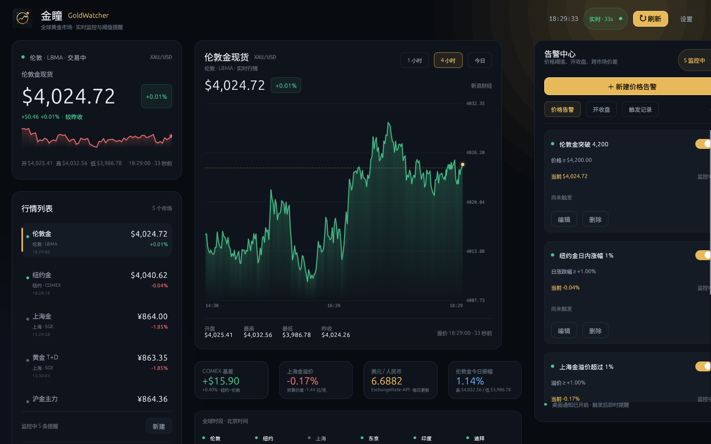

# 金瞳 GoldWatcher

> 全球黄金市场实时监控与开收盘 / 价格告警工具  
> A desktop gold market monitor with price and session alerts, built in Rust.



金瞳 GoldWatcher 是一个面向个人投资者的轻量桌面工具。它同时盯住伦敦现货、纽约 COMEX、上海黄金交易所和上海期货交易所的黄金报价，并把跨市场基差、上海金溢价、人民币汇率、全球交易时段集中在一个界面里。

数据时效优先：启动后并**并发**请求秒级现货源与新浪多市场行情，按数据源时间戳选择更新的一条；默认每 **15 秒**刷新，可切换 15 / 60 / 120 / 300 秒。

## 功能

- **五个黄金市场实时行情**：伦敦金 XAU/USD、COMEX 黄金 GC、上海金 Au99.99、黄金 T+D、沪金主力
- **跨市场指标**：COMEX 基差、上海金溢价（按 USD/CNY 折算）、美元/人民币汇率、伦敦金今日振幅
- **走势图**：今日分钟走势、1 小时 / 4 小时 / 今日窗口、昨收虚线、十字光标
- **价格告警**：任一市场「价格」或「日涨跌幅」高于 / 低于阈值
- **价差告警**：COMEX 基差、上海金溢价、USD/CNY 汇率
- **开收盘提醒**：伦敦、纽约、上海日盘 / 夜盘、东京日盘 / 夜盘、印度、迪拜，可选择开盘、收盘或两者
- **提醒方式**：桌面系统通知、窗口闪烁请求、应用内浮层；支持重复提醒与冷却时间
- **本地持久化**：告警、触发记录和历史走势写入本地 JSON，重启自动恢复
- **系统托盘**：Linux / Windows 托盘图标，可显示窗口、立即刷新、退出
- **开机自启**：Linux 写入 XDG autostart；Windows 写入当前用户注册表 Run 项
- **中文界面与内置图标**：深色金色主题，随程序打包中文字体，窗口 / 托盘 / 桌面图标一致

## 覆盖市场

| 市场 | 标的 | 单位 | 时段（北京时间，参考） |
|---|---|---|---|
| 伦敦 | 现货黄金 XAU/USD | 美元/盎司 | 周一至周五，全天 |
| 纽约 | COMEX 黄金 GC | 美元/盎司 | 06:00–次日 05:00 |
| 上海黄金交易所 | 上海金 Au99.99 | 元/克 | 09:00–15:30 / 20:00–次日 02:30 |
| 上海黄金交易所 | 黄金 T+D | 元/克 | 09:00–15:30 / 20:00–次日 02:30 |
| 上海期货交易所 | 沪金主力 AU | 元/克 | 09:00–15:30 / 21:00–次日 02:30 |
| 全球参考 | 美元/人民币 | CNY | 每日更新 |

界面底部的「全球时段」额外展示伦敦、纽约、上海、东京、印度、迪拜的开市 / 休市状态。

> 交易时段为公开资料整理的近似值，不处理节假日、夏令时切换和交易所临时调整。开收盘提醒仅作为看盘辅助。

## 告警规则

价格告警支持以下监控对象：

- 任一市场的**价格**或**日涨跌幅**
- **COMEX 基差**（纽约金 − 伦敦金，美元/盎司）
- **上海金溢价**（上海金 vs 国际折算价，%）
- **美元/人民币汇率**

每条告警可设置：

- 高于 / 低于阈值
- 一次性提醒，或持续满足时重复提醒
- 重复冷却时间（30 秒–24 小时）
- 桌面通知 / 窗口闪烁 / 启用状态

开收盘提醒单独管理：

- 伦敦盘、纽约 COMEX、上海日盘、上海夜盘、东京日盘、东京夜盘、印度 MCX、迪拜 DGCX
- 可选开盘、收盘或两者都提醒
- 应用启动时以当前开闭市状态为基准，不会在启动瞬间误报

## 数据源与时效

| 来源 | 用途 | 说明 |
|---|---|---|
| [Gold-API](https://gold-api.com/) | 伦敦金秒级现货 | 免费、无需 Key，响应含源时间戳 |
| [新浪财经](https://finance.sina.com.cn/) | 五市场多标的行情、伦敦/纽约分钟线 | 需携带 Referer，批量请求延迟低 |
| [上海黄金交易所](https://www.sge.com.cn/) | 上海金 Au99.99 分钟线 | 公开图表接口，可能延时 |
| [ExchangeRate-API](https://www.exchangerate-api.com/) | USD/CNY、USD/JPY、USD/INR | 免费开放汇率，每日更新 |

- 两个行情源通过独立线程**并发抓取**，合并时比较数据源时间戳，优先采用更新的报价。
- 界面的「实时 · Ns」显示的是**数据源报价时间**与本机时间的差，不是 HTTP 请求耗时。
- 抓取耗时、最近成功时间和降级警告可在顶部状态悬浮提示与「设置」中查看。
- 任一来源失败时，界面显示「降级 / 重试中」，并保留上一次成功数据，不会伪造实时价格。
- 公开接口可能限流、延迟、调整字段或停止服务。本项目不保证行情适合交易决策。

## 构建

要求 Rust 1.89+（推荐最新 stable）。

### Linux

系统依赖（Debian / Ubuntu）：

```bash
sudo apt install build-essential pkg-config libgtk-3-dev \
  libayatana-appindicator3-dev libxkbcommon-dev \
  libwayland-dev libx11-dev
```

Arch Linux：

```bash
sudo pacman -S base-devel gtk3 libayatana-appindicator libxkbcommon wayland
```

构建与运行：

```bash
cargo build --release
./target/release/gold-watcher
```

安装到当前用户（二进制、图标、桌面快捷方式）：

```bash
./scripts/install.sh
```

默认安装到 `~/.local/bin/gold-watcher`。

### Windows

1. 安装 [Rust MSVC 工具链](https://rustup.rs/) 和 Visual Studio Build Tools（“使用 C++ 的桌面开发”）。
2. 在项目目录打开 PowerShell：

```powershell
cargo build --release
.\scripts\install.ps1
```

安装脚本会把程序放到 `%LOCALAPPDATA%\Programs\GoldWatcher`，并创建桌面与开始菜单快捷方式。Windows 可执行文件的图标由 `build.rs` + `winres` 嵌入（需要在 Windows 上构建）。

> 在 Linux 上交叉编译 Windows 版本可行，但 `winres` 图标嵌入只在本机 Windows 构建时启用。

## 存储位置

| 平台 | 配置 | 历史走势 |
|---|---|---|
| Linux | `~/.config/goldwatcher/config.json` | `~/.local/share/goldwatcher/history.json` |
| Windows | 当前用户 AppData 下的 GoldWatcher 配置目录 | 当前用户 AppData 下的 GoldWatcher 数据目录 |

也可以在「设置 → 数据与存储」直接打开配置目录。配置采用临时文件 + 原子重命名写入；损坏的配置会重命名备份后回退默认值。

## 项目结构

```text
src/
  main.rs      窗口入口、图标、eframe 配置
  app.rs       三栏界面、走势图、告警与设置弹窗
  data.rs      并发行情抓取、解析、后台刷新线程
  model.rs     市场/报价/告警/开收盘提醒/配置模型
  alerts.rs    价格告警穿越、重复与冷却评估
  storage.rs   配置与历史持久化、开机自启
  theme.rs     深色金色主题与字体
  tray.rs      Linux / Windows 系统托盘
  notify.rs    桌面通知
assets/        图标、字体、界面截图
scripts/       Linux / Windows 安装脚本
```

## 测试

```bash
cargo test
cargo clippy --all-targets
```

测试覆盖行情字段解析、上海金跨午夜走势、跨市场指标、告警穿越 / 冷却以及全球交易时段边界。

## 免责声明

本项目仅用于学习和信息展示，不构成投资建议。行情可能延迟、缺失或错误；黄金交易具有风险，请独立判断并自行承担交易结果。使用公开数据接口时请遵守对应网站的服务条款。

## 字体与图标

- 界面内置字体 `GoldWatcherSans-Regular.otf` 由 Noto Sans CJK SC 子集化并重命名，遵循 SIL Open Font License 1.1，许可证见 `assets/FONT-LICENSE.txt`。
- 应用图标为 GoldWatcher 原创 SVG / PNG / ICO 资源。

## License

MIT
